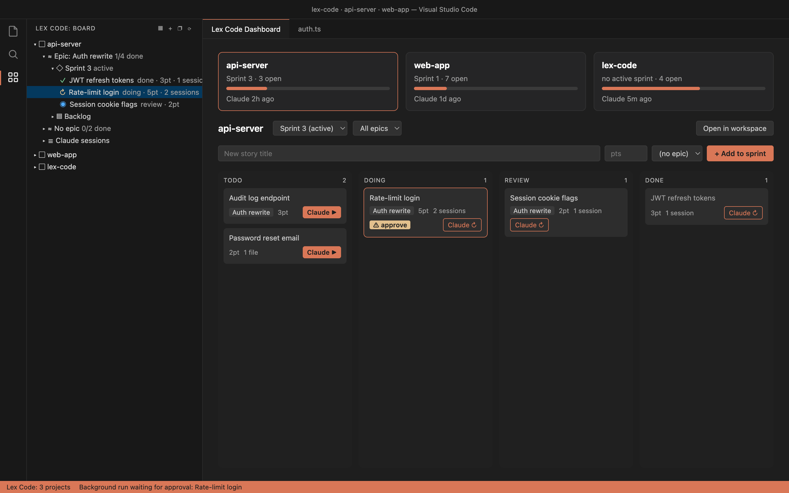

# LexCode

Agile project manager for concurrent projects with Claude Code sessions — a VS Code extension.



## Why "LexCode"?

It started as **"let's code"**, said out loud more times a day than anyone would admit: at the start of every sprint, every new story, every fresh Claude session. Juggling three projects at once, the phrase got shorter each time — *let's code… lets-code… lex-code* — until it was just one word muttered at the terminal.

When the tool that kept all those projects, sprints and sessions in one place needed a name, there was only one candidate. LexCode is what "let's code" sounds like when you've already said it a hundred times today and still mean it.

## Install

```sh
npm install
npm run compile
npx @vscode/vsce package
code --install-extension lex-code-0.0.4.vsix
```

Or press F5 in VS Code to try it in an Extension Development Host.

### Manual install (after compile)

Once `npx @vscode/vsce package` has produced `lex-code-0.0.4.vsix` in the project root:

1. Open the **Extensions** view (`Cmd+Shift+X` / `Ctrl+Shift+X`).
2. Click the **`…`** (Views and More Actions) menu at the top of the view.
3. Choose **Install from VSIX…**.
4. Select `lex-code-0.0.4.vsix` and reload the window when prompted.

Alternatively, run **Extensions: Install from VSIX…** from the Command Palette (`Cmd+Shift+P` / `Ctrl+Shift+P`).

### Install in Devin

Devin's editor is VS Code-based, so it installs the same `.vsix`:

1. Build the package as above (or copy `lex-code-0.0.4.vsix` into the Devin workspace).
2. In Devin's editor, open the **Extensions** view → **`…`** menu → **Install from VSIX…**, and pick the file.
   - Or from Devin's terminal: `code --install-extension lex-code-0.0.4.vsix`
3. Reload the window; the **LexCode** icon appears in the activity bar.

Background runs and the sparkle action need the `claude` CLI available in Devin's environment (set `lexCode.claudePath` if it isn't on `PATH`).

### Use without VS Code (`lexcode ui`)

The same dashboard runs in your browser, with Claude sessions in browser terminal tabs:

```sh
npm install -g github:buffer808/LexCode   # or, from a clone: npm install -g .
lexcode ui                                 # opens http://127.0.0.1:7420/?t=<token>
```

- **Board:** shares `board.json` with the extension when VS Code (or Cursor, Windsurf, …) has one, so both stay in sync and can run at once; otherwise `~/.lexcode/board.json`. Override with `LEXCODE_BOARD`.
- **Attach / Claude ▶ / resume** open a new window of your default terminal app running `claude attach …` (or the session) in the project. On macOS that's whichever app opens `.command` files (Terminal, or iTerm etc. if you made it the default); on Linux `$TERMINAL`, else `x-terminal-emulator`/`gnome-terminal`/`konsole`/`xterm`; on Windows `cmd`. Closing the window detaches; a background run keeps going. Prefer terminals in the browser? Set `"lexCode.ui.terminal": "browser"`.
- **Factory:** `lexcode ui` drives factory epics too; the per-epic lock means only one window (browser server or VS Code) drives each epic.
- **Settings:** `~/.lexcode/settings.json`, same keys as VS Code, e.g. `{ "lexCode.claudePath": "/opt/homebrew/bin/claude", "lexCode.factory.targetBranch": "dev" }`.
- **Differences:** *Add project* takes a folder path; *Import tasks* imports everything in TASKS.md (no picker or Claude review); files open in VS Code (`code`) if it's on `PATH`, else the system default app.
- **Security:** listens on `127.0.0.1` only and needs the token in the printed link (kept in `~/.lexcode/ui-token`, stored as a cookie). Anyone with that link can run Claude on your projects, so don't share it. Options: `--port <n>`, `--no-open`, `--verbose`.
- Needs Node 20+. On Linux, `node-pty` compiles on install (needs `python3`, `make`, a C++ compiler).

### Use in the terminal (`lexcode tui`)

The board in your terminal, drawn like Claude Code: events print into the scrollback, and the task list, prompt box and status line stay live under them.

```sh
lexcode          # same as `lexcode tui`
```

- **Prompt:** type a story and press `⏎` to add it to the current project. `/` opens the command menu (`tab` or `⏎` completes); `@` names a task, as in `/move review @login`. `\⏎` adds a line, `ctrl+g` edits the prompt in `$EDITOR`, `esc` clears it, `ctrl+c` clears, then quits. `/help` lists every command.
- **Views** (`shift+tab` cycles, or `/tasks`, `/board`, `/epics`, `/projects`):
  - **tasks:** the project's work grouped as Needs you (sessions asking for permission, epic gates), Running (with each run's latest action under it), Up next, Review, and a count of Done. `←`/`→` switch project.
  - **board:** To do / Doing / Review / Done columns. Arrows move the highlight, `shift+←`/`shift+→` (or `/move done`) move the task. Under the board: the highlighted task's run and latest action. Below 100 columns it becomes one list grouped by status.
  - **epics:** each factory epic's stage, then the selected epic's pipeline and sprints, with reviewers and blockers under them. `←`/`→` pick an epic, `↑`/`↓` move over its sprints. The status line lists the commands valid right now, the same actions as the dashboard's buttons:
    - plan: `/plan`, `/plan-source`, `/approve`, `/changes`, `/reject`;
    - build: `/start`, `/pause`, `/resume`, `/builders`, `/cancel`;
    - sprint: `⏎` (or `/attach`) the running builder, reviewer or fix session, `/merge`, `/send-back`, `/retry`, `/skip`;
    - PR: `/pr` (gh, tea, or a Claude skill), `/pr-opened` for the URL a skill opened, `/open-pr`.
  - **projects:** every project with what needs you, what runs, task counts (to do/doing/review/done), active epics and the last Claude activity. `⏎` opens one.
- **`⏎` on an empty prompt** opens what's selected: a task's Claude session, an epic, a project. `/attach --new` starts a fresh session. **`space`** peeks at the selected task's transcript without attaching (`space` or `esc` closes).
- **Questions** show as numbered choices in a box (`↑`/`↓` and `⏎`, or the number; `esc` for later).
- **`/epic`** asks the dashboard form's questions in turn: title, how builders run, description, target branch, models, reference files (comma-separated paths, at most 20 files of 25 MB). Nothing is created until you confirm; `esc` cancels.
- **`/next`** jumps to the next thing waiting on you, in any project: a plan or PR gate, a merge to approve, a blocked sprint or story, or a session asking for permission.
- **Where Claude opens:** in a box over the list, inside LexCode's own screen (it runs `claude` in an embedded terminal). Everything you type goes to Claude; `ctrl+]` closes the box and the session keeps running (`⏸ parked`), and opening the task again brings it back. Quitting LexCode stops sessions running inside it (after asking); their transcripts stay, so attaching resumes them.
  - **`/split`** puts Claude beside the list instead (terminal 120+ columns wide). `ctrl+]` switches the keyboard between list and Claude, `⏎` on another task shows that one in the pane, `ctrl+\` closes the split.
  - **`/attach --tab`** opens the session in a new tab of your terminal instead: iTerm2, WezTerm, kitty (with `allow_remote_control`), GNOME Terminal, Konsole, or a tmux window when LexCode runs inside tmux. Other terminals get a new window (macOS Terminal and Ghostty make it a tab when the system prefers tabs).
  - `"lexCode.tui.terminal": "inline"` in `~/.lexcode/settings.json` lets Claude take over the whole terminal until it exits, instead of the box.
- **Long text** (epic description, plan changes, send-back notes) opens in `$VISUAL`/`$EDITOR` in the same box. Text below the `>8` line is help and is dropped; leave it empty to cancel. `/plan` shows the plan with `glow` if installed, else `less`.
- Shares `board.json`, settings, and factory locks with VS Code and `lexcode ui`. The factory advances while any of them runs; quitting one hands its epics to the others at once.
- Logs go to `~/.lexcode/tui.log`.

## Usage

Open the **LexCode** icon in the activity bar to see the **Board** view.

1. **Add a project** — click `+` in the Board title bar and pick one or more folders. Each is tracked separately. If the folder has a `TASKS.md`, LexCode offers to import it (see [Import tasks](#import-tasks-from-tasksmd)).
2. **Plan work** — hover a project for inline actions:
   - **New Epic** groups related stories.
   - **New Sprint** creates a sprint; **Start Sprint** (play icon) makes it active.
   - **New Story** adds a story (title, points, description, epic, sprint). Stories without a sprint sit in the backlog.
3. **Track progress** — on a story, use **Set Status** (`todo` → `doing` → `review` → `done`) and **Edit Story**. Right-click to delete stories, sprints, or epics.
4. **Work with Claude** — click the sparkle icon on a story to open a Claude Code session seeded with the story as the prompt. Session IDs are saved on the story so you can resume later.
   - Background runs use `claude --bg`; you get a notification when a run changes state or is blocked waiting for approval, and can attach to it in a terminal.
5. **Dashboard** — click the dashboard icon in the Board title bar for a kanban view across all projects:
   - Filter each project by sprint and epic, add stories inline, and drag cards between `todo` / `doing` / `review` / `done`.
   - Cards show epic, points, attachments, linked sessions, and a **⚠ approve** badge when a background run is waiting on you; **Claude ▶** starts a session, **Claude ↻** resumes one. While a background run is in progress (yours or the factory's builder/reviewer), the button becomes **Attach** (or **⚠ Approve…**), here and on the story in the Board view.
   - Click a card to open the story dialog: edit fields, paste or drop image attachments, see files Claude edited, and manage sessions — **Attach**, **Run in background** (with a per-run permission mode), **Unlink**, or link an existing session.
6. **Open projects** — open one project, or all of them, as workspace folders from the title bar or a project's inline actions.

### Import tasks from TASKS.md

Run **Import Tasks from TASKS.md** (or the dashboard's **Import tasks** button). LexCode finds the shallowest `TASKS.md` in the project and parses it:

- `## Epic: X`, `## Sprint 3`, `## Backlog` headings set context; list items under them (or checkbox items anywhere) become stories. Indented items join the story's description.
- `- [x]`, `~~struck~~`, ✅ or words like *done* / *archived* mark closed work, which is skipped. `[~]` / `[/]` means doing.
- Local links to other `.md` files are followed (except *archive* / *done* files).

You then choose **Review with Claude** — Claude checks the tasks against the code with you and writes the keepers to `.lexcode/import.md`, after which the picker opens — or **Pick manually**. Duplicates are skipped.

### Sync from TASKS.md

After import, keep editing TASKS.md and run **Sync from TASKS.md** (project context menu) to push the changes to the board: ticked items become `done`, `[~]` becomes `doing`, new items are added, renamed lines are matched by position, and items removed from the markdown are archived. Stories created on the board are never touched. Pick an epic to sync only that epic (`--epic` on the CLI).

If the project was imported with **Review with Claude**, sync reads `.lexcode/import.md` instead and checks each story's original line (via its `src` comment), so work Claude weeded out isn't re-added. Items added to TASKS.md after the review need another review import.

The same sync runs headless, for Claude Code or scripts:

```sh
node ~/.vscode/extensions/lex.lex-code-0.0.4/out/cli.js sync [projectPath] [--dry-run] [--epic <name>]
# or, with lexcode installed globally:
lexcode sync [projectPath] [--dry-run] [--epic <name>]
```

It finds `board.json` in your editor's global storage (override with `LEXCODE_BOARD`).

#### Claude Code skill

[skills/lexcode-sync](skills/lexcode-sync/SKILL.md) previews the sync, asks you to confirm, then applies it. Install it once for every project:

```sh
mkdir -p ~/.claude/skills/lexcode-sync && cp skills/lexcode-sync/SKILL.md ~/.claude/skills/lexcode-sync/
```

Then say "sync tasks to LexCode" or run `/lexcode-sync` in any tracked project.

All commands are also available from the Command Palette under `LexCode:`.

### Software factory (preview)

The pipeline is **Planning** (plan → revalidate → security) → **your approval** → **Build** → **Review** (revalidate + security + your reviewers) → **PR**.

Adding an epic first cuts the epic branch, `lexcode/<epic>-<id>`, from the latest target branch (`origin/<target>` after a fetch, else the local branch). It is checked out in its own worktree under `.lexcode/worktrees/`, so your checkout is never switched. Planning then runs there in the background with `claude --bg`, read-only in plan mode:

1. **Plan:** an orchestrator breaks the epic into sprints and stories, with dependencies and parallel-safe flags.
2. **Revalidate:** the plan is checked against the code. Existing code is reused, dependencies are confirmed, and affected files are listed.
3. **Security check:** findings are rated low, medium or high per sprint.
4. **Your approval:** the epic strip on the dashboard (or a notification) offers **View plan**, **Approve plan**, **Request changes** (sent back to the orchestrator) and **Reject**. Approving adds the sprints and stories to the board in TODO.

After approval, set the number of **Builders** and click **▶ Start build**. LexCode then:

1. Starts sprints once their dependencies are merged. *Parallel-safe* sprints run side by side, up to the builder count, each on its own branch and worktree. A sequential sprint always runs alone.
2. Works through each sprint's stories one at a time:
   - A **builder** session implements the story and commits it. It runs in the builder mode chosen for the epic.
   - A read-only **reviewer** (the first one you picked) checks the story's diff.
   - A failed review goes back to the same builder session, with the issues to fix. After `maxReviewAttempts` failures the story stops and waits for you: **Retry**, **Take over** (attach) or **Skip**.
3. Runs the **sprint review panel** on the whole sprint's diff once its stories are done. These run in parallel, read-only, and all must pass:
   - the **revalidator** again, now on the code: reuse, dependencies, affected callers, anything missing;
   - the **security** agent again, now on the code;
   - every **reviewer** you picked for the epic (for example an accounting reviewer and an N+1 hunter).

   Any failure becomes one fix session with every reviewer's issues, followed by another full panel.
4. Merges the sprint into the epic branch automatically, unless the merge is critical. It is critical when:
   - any panel reviewer flagged it as critical,
   - it changes a file matching `sensitivePaths`,
   - the plan has a medium or high security finding for that sprint, or
   - it conflicts with the epic branch.

   Critical merges wait for **Approve merge**, or **Send back** with a note for a fix session. After a merge, the sprint's worktree and branch are deleted.
5. Asks to **Create PR** when every sprint is merged. It pushes the epic branch, then opens the PR against the target branch **with**:
   - **GitHub (gh):** `gh pr create`.
   - **Gitea (tea login):** the Gitea API, using the token of your `tea` login whose host matches `origin` (else the default login). Works when `origin` is an IP that `tea pr create` can't map.
   - **Claude skill:** your own PR skill or command (for example `/git-release`), started in a terminal at the project root as `/<skill> <target> <epic branch>`. It drafts and opens the PR with you; paste the PR URL back into the dashboard to finish the epic.
   - **Auto:** gh for GitHub remotes, Gitea otherwise.

   The choice is remembered per project. Errors show in the PR box.

Use **⏸ Pause** to stop new sessions from starting; running ones finish. Background runs that need a permission approval show **⚠ Approve…**.

- **Creating a factory epic:** use **+ Epic** on the dashboard or **LexCode: New Epic**. You choose:
  - the builder mode: *Accept edits* or *Full auto*;
  - the target branch (the epic branch is cut from it; the PR goes back into it);
  - the agent for each planning and build role, and one or more reviewers for the review panel;
  - optionally, the model and effort for each role.
- **Existing epics:** run **Run Software Factory on Epic** from an epic's context menu.
- **From the command line:** `lexcode epic new` creates the epic and starts planning, then exits. Planning carries on as a Claude background session; the epic reaches the plan gate while VS Code, `lexcode ui` or `lexcode` is running.

  ```sh
  lexcode epic new --title "Add CSV export" --description-file spec.md --target-branch main
  lexcode epic new --from - --json < epic.json   # same fields as the dashboard form, as one JSON object
  ```

  Other options: `--mode accept-edits|auto` (default accept edits), `--planner-model`/`--planner-effort` and the same for `builder` and `reviewer`, `--attach <file>` (repeatable). It works from any folder inside a tracked project.
- **From Claude Code:** `/lexcode-factory <epic title and description>`. Inside an editor with LexCode it opens the same prompts there, with the description filled in. Anywhere else it asks for the builder mode and target branch in chat and runs `lexcode epic new`. Install the skill once:

  ```sh
  mkdir -p ~/.claude/skills/lexcode-factory && cp skills/lexcode-factory/SKILL.md ~/.claude/skills/lexcode-factory/
  ```
- **Your own agents:** agents in the project's (or your) `.claude/agents/` are used for matching roles, matched by name: *orchestrator/planner/architect/lead*, *validator/analyst*, *security/audit*, *review/qa*, *builder/developer/engineer*. Every other agent is offered to each session as a subagent to delegate to. To map agents explicitly, add `.lexcode/factory.json` to the project:

  ```json
  { "roles": { "orchestrator": "tech-lead", "reviewer": "code-reviewer" } }
  ```

  LexCode's own prompts (`agents/` in this extension) cover any role left unmapped.
- **Models:** planning stages default to Opus at high effort.
- **Requirements:**
  - The project must be a git repository.
  - Claude Code must trust the folder: run `claude` there once.
  - Creating PRs needs the GitHub CLI (`gh`) logged in, a `tea` login for Gitea, or a PR skill.
- **Where plans are stored:** `.lexcode/epics/<epicId>/plan.{json,md}`. `.lexcode/` is added to `.git/info/exclude`.

#### What the factory picks up

The factory works on **epics**, not single stories. It builds only stories that its own plan put into the epic's sprints. Stories you add by hand are treated like this:

| Where the story is | Built by the factory? |
| --- | --- |
| Backlog (no sprint), even when linked to a factory epic | No |
| A factory sprint that hasn't started yet | Yes, when the sprint starts |
| A factory sprint that is building | Yes, after the stories ahead of it |
| A factory sprint in review, fixing, waiting for merge, or merged | No. It stays in TODO and the sprint goes on without it |
| A manual (non-factory) epic or sprint | No |

The orchestrator plans from the epic's **title and description only**. It doesn't read stories already on the epic, and it creates new stories of its own. To automate work you've already written as a story, see [Automate a backlog story](#automate-a-backlog-story).

## Use cases

### Track several projects by hand (no automation)

1. **Add Project** for each folder.
2. Create epics and sprints. When asked how builders should run, choose **Manual epic**, or turn off `lexCode.factory.autoStart`.
3. Add stories, then move them across `todo` → `doing` → `review` → `done`, in the Board view (**Set Status**) or by dragging cards on the dashboard.

### Bring an existing TASKS.md onto the board

1. **Import Tasks from TASKS.md** → **Review with Claude** (Claude weeds out finished or obsolete items) or **Pick manually**.
2. Keep editing TASKS.md, then run **Sync from TASKS.md** or `/lexcode-sync` to push the changes. See [Sync](#sync-from-tasksmd).

### Work on one story with Claude, yourself

- **Interactive:** click the sparkle icon (or **Claude ▶** on the card). The session starts with the story's title, description and attachments, and is saved on the story.
- **Background:** open the card → **Run in background**, and pick a permission mode. You get a notification when it finishes or needs approval. Use **Attach** to step in.
- **Pick up later:** **Claude ↻** / **Resume Claude Session** reopens the saved session.

### Build a feature end to end with the factory

1. **+ Epic** on the dashboard (or **New Epic**). Describe the goal, constraints and acceptance criteria. This description is all the orchestrator sees.
2. Wait for the plan → **View plan** → **Approve**, or **Request changes**.
3. Set **Builders** → **▶ Start build**.
4. Step in only when asked: a story that failed review too many times, a critical merge, or the final **Create PR**.

### Automate a backlog story

No single-story command exists yet. Wrap the story in an epic instead:

1. Create a manual epic named after the story (or reuse an existing one).
2. Right-click the epic → **Run Software Factory on Epic**. When asked for a description, paste the story's description and acceptance criteria.
3. Once the plan is approved, the factory creates its own stories for this work. Archive or delete the original backlog story so it doesn't sit there twice.

### Add work to a factory epic that is already running

- Add the story to a factory sprint that is **waiting** or **building**. The factory builds it in order.
- If every sprint is past building, the factory won't build the story. Do it yourself with Claude ([see above](#work-on-one-story-with-claude-yourself)), or plan it as a new epic.

### Rework or stop a factory epic

- **Plan is off:** at the plan gate, choose **Request changes** with a note. The orchestrator revises the plan.
- **Sprint is off:** on a critical merge, choose **Send back** with a note. A fix session runs, then the review panel runs again.
- **Stuck story:** **Retry**, **Take over** (attach and finish it yourself) or **Skip**.
- **Stop:** **⏸ Pause** stops new sessions; **Cancel** ends the epic. A cancelled or failed epic can be restarted with **Run Software Factory on Epic**.

### Use your own agents and reviewers

Add agents to `.claude/agents/`. LexCode matches them to roles by name, or you can map them in `.lexcode/factory.json`. When creating the epic, pick any of them as reviewers. All of them must pass before a sprint merges.

## Commands

All commands are in the Command Palette under `LexCode:`. Most also appear as inline or right-click actions in the Board view.

| Command | What it does |
| --- | --- |
| Add Project / Remove Project | Track or stop tracking a folder. When removing, you choose to keep or delete its board tasks; project files are never touched. |
| Open Project in Workspace / Open All Projects in Workspace | Add project folders to the current workspace. |
| Open Dashboard | Kanban view across all projects, with factory controls. |
| Refresh | Redraw the Board view. |
| New Epic | Create a factory epic, or a manual one. |
| Run Software Factory on Epic | Start the factory on a manual, cancelled or failed epic. |
| Open Factory Plan | Open the epic's `plan.md`. |
| New Sprint / Start Sprint | Create a sprint / make it the active sprint. |
| New Story / Edit Story / Set Status | Manage stories. |
| Delete | Delete a story, sprint or epic. Deleting a sprint moves its stories to the backlog. |
| Open Claude Session | Start a Claude Code session for the story. |
| Resume Claude Session | Reopen a session linked to the story. |
| Attach to Background Run | Open a terminal on the story's background run, for example to approve a permission. |
| Import Tasks from TASKS.md / Sync from TASKS.md | See [Import](#import-tasks-from-tasksmd) and [Sync](#sync-from-tasksmd). |

## Settings

| Setting | Default | Description |
| --- | --- | --- |
| `lexCode.claudeLauncher` | `auto` | `auto`: use the Claude Code extension if installed, else the CLI. `cli`: always run `claude` in a terminal. |
| `lexCode.backgroundPermissionMode` | `manual` | Permission mode for background runs: `manual`, `acceptEdits`, `plan`, `auto`, `bypassPermissions` (dangerous). |
| `lexCode.tasksScanSkip` | `node_modules`, `.git`, `out`, `dist`, … | Folder names skipped when searching for `TASKS.md`. Empty list scans everything. |
| `lexCode.claudePath` | _(auto)_ | Path to the `claude` CLI. |
| `lexCode.tui.terminal` | `auto` | `lexcode tui` only: where Claude opens. `auto` (a box inside LexCode, or beside the list with `/split`) or `inline` (Claude takes over the terminal until it exits). |
| `lexCode.factory.autoStart` | `true` | New epics start the software factory. Off: **New Epic** only creates the epic. |
| `lexCode.factory.builderPermissionMode` | `acceptEdits` | Builder mode preselected for new factory epics: `acceptEdits` or `auto` (Full auto). |
| `lexCode.factory.targetBranch` | `main` | Default PR target branch. |
| `lexCode.factory.models` | planner: `opus` / `high` | Model and effort for each role (`planner`, `builder`, `reviewer`). A project agent's own frontmatter `model` overrides this setting; a model picked for the epic overrides both. |
| `lexCode.factory.defaultWorkers` | `1` | Builders preselected when starting a build (max 8). |
| `lexCode.factory.maxReviewAttempts` | `3` | Review failures per story or sprint before the factory asks you to step in. |
| `lexCode.factory.sensitivePaths` | auth, migrations, CI, `package.json`, lockfiles, `.env`, `Dockerfile` | Gitignore-style globs. A sprint that changes a matching file waits for your approval before it merges. |

## Data

The board is stored as `board.json` in the extension's global storage; story attachments live beside it in `attachments/<storyId>/`.

## Develop

```sh
npm run watch   # rebuild on change
npm test        # compile + node:test
```
